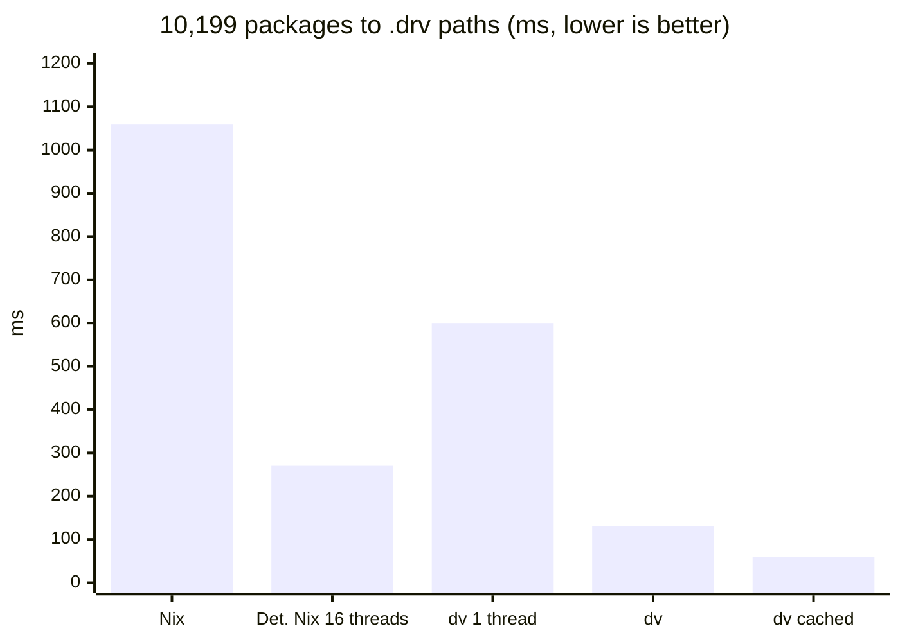

# dv

An experimental Nix derivation compiler. 8–87x faster than Nix + nixpkgs, and 1.8–17x
faster than Nix + repkgs.

Packages are written in Starlark, and dv compiles them to ordinary Nix store derivations
(`.drv` files) that the Nix daemon builds as usual. It does not run Nix code, so existing package
sets have to be rewritten in Starlark.

[dvpkgs](https://github.com/joshheinrichs/dvpkgs) is such a rewrite of
[repkgs](https://github.com/Mic92/repkgs). Its `.drv` files are byte-identical to the ones
`nix-instantiate` produces from repkgs.

## At a glance

Measured as the time to evaluate packages to their `.drv` files:

- **vs Nix + nixpkgs**, the same 177 packages: 8x for a single package (jq), 66x for all 177,
  87x with dv's cache. Much of this is repkgs' design rather than dv: nixpkgs' versions of the
  same packages have 8–20x larger build graphs. Per derivation, dv is 2–3.3x faster.
- **vs Nix + repkgs**, the identical `.drv` files: 1.8x on one thread, up to 8x on all cores,
  up to 17x with dv's cache. The gains grow with the size of the package set.

## What Starlark gives a package set

- **Frozen values, parallel for free.** A Starlark module freezes once it is loaded. Threads
  share it without locks, so packages evaluate in parallel on every core. Nix values are thunks
  that any thread may be forcing at the same time.
- **A cache that knows what each package read.** Loads are explicit and evaluation is
  deterministic. dv records every file, directory and dependency a package reads, and skips the
  package next time if none of it changed. Editing one package re-evaluates that package, and
  its dependents only if its result changed.
- **Strict by default, lazy where asked.** Only the package set itself is lazy (`lazy_attrs`).
  Everything else is a plain value, computed where it is written, with no thunk behind it.
- **Fixpoints without overlays.** A package set refers to itself by being rebuilt with the same
  arguments, which gives back the same set. There is no `self`/`super` and no infinite
  recursion through it.
- **Hermetic, and familiar.** Starlark is a Python dialect with no I/O, no clock and no mutable globals. A
  package file can only read what dv's builtins hand it, and those reads are what the cache
  tracks.

See [docs/design.md](docs/design.md) for how each of these works.

## Speed

### Against repkgs and nixpkgs

Evaluating a package to its `.drv` path evaluates its whole build graph: every dependency,
source and bootstrap stage is a derivation of its own. The same package names have much larger
graphs in nixpkgs than in repkgs, so the derivation count is part of each row, and the time per
derivation is the like-for-like figure.

The 177 packages that repkgs and nixpkgs both have, paired by repkgs'
[bench/eval.nix](https://github.com/Mic92/repkgs/blob/main/bench/eval.nix):

| | evaluator | derivations | time | per derivation | peak memory |
|---|---|---|---|---|---|
| nixpkgs | Nix 2.35 | 8,839 | 1.43s | 162µs | 662MB |
| repkgs | Nix 2.35 | 440 | 62ms | 141µs | 69MB |
| dvpkgs | dv, one thread | 440 | 35ms | 79µs | 57MB |
| dvpkgs | dv, all cores | 440 | 22ms | 49µs | 135MB |
| dvpkgs | dv, cached | 440 | 16ms | 37µs | 72MB |

jq alone:

| | evaluator | derivations | time | peak memory |
|---|---|---|---|---|
| nixpkgs | Nix 2.35 | 636 | 105ms | 132MB |
| repkgs | Nix 2.35 | 76 | 32ms | 62MB |
| dvpkgs | dv | 76 | 13ms | 38MB |

For one package, startup and the shared toolchain dominate, so time per derivation means little
there. nixpkgs' 8,839 derivations include 564 for its stdenv; the rest are the packages' own
dependencies. Per derivation, Nix costs about the same on either set; repkgs is cheaper to
evaluate because its packages need fewer derivations.
[repkgs/docs/eval.md](https://github.com/Mic92/repkgs/blob/main/docs/eval.md) covers the
caveats in more detail.

### At scale

Every package of a 10,199-package set: repkgs/dvpkgs plus 10,000 variants of jq, each in its
own package file ([bench/synthetic](bench/synthetic)). Both sides produce the same paths, which
is checked before timing.

| | time | memory | vs Nix |
|---|---|---|---|
| repkgs, Nix 2.35 | 1.06s | 279MB | |
| repkgs, Determinate Nix 3.23, 16 threads | 0.27s | ~420MB | 3.9x |
| dvpkgs, dv cold, one thread | 0.60s | 298MB | 1.8x |
| dvpkgs, dv cold, all cores | 0.13s | 407MB | 8x |
| dvpkgs, dv, first run filling an empty cache | 0.15s | 377MB | 7x |
| dvpkgs, dv warm (nothing changed) | 0.06s | 228MB | 17x |
| dvpkgs, dv after editing one package | 0.06s | 226MB | 17x |

Determinate Nix evaluates in parallel (`--eval-cores`, `nix eval --json`). It scales about as
well as dv, roughly 4x on 8 cores, but stays about 2x slower than dv cold. Nix has no
per-package cache, so every Nix run is a cold run. repkgs builds its package list serially;
~100ms of that is 10k `builtins.pathExists` checks, which don't speed up with threads even under
`builtins.parallel`.

### Method

Every run evaluates read-only to `.drv` paths, writing nothing to the store. Times are the best
of 3 runs for the 10,199-package set ([bench/scale](bench/scale)) and the mean of 5 otherwise.
nixpkgs is the revision repkgs pins,
[02f5696](https://github.com/NixOS/nixpkgs/commit/02f5696b0e6097e589076d886b317b83ff0437d7),
with no overlays. Memory is peak RSS from GNU time. Machine: AMD Ryzen 7 9800X3D (8 cores, 16
threads).
